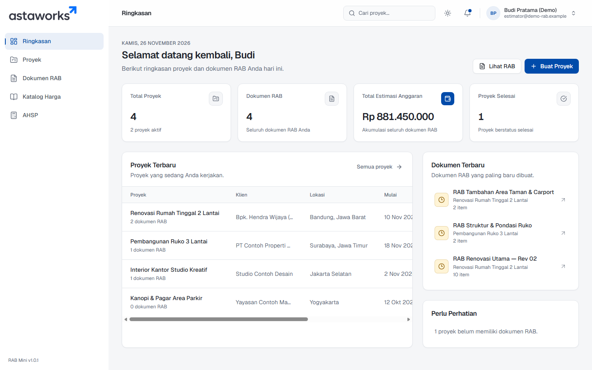
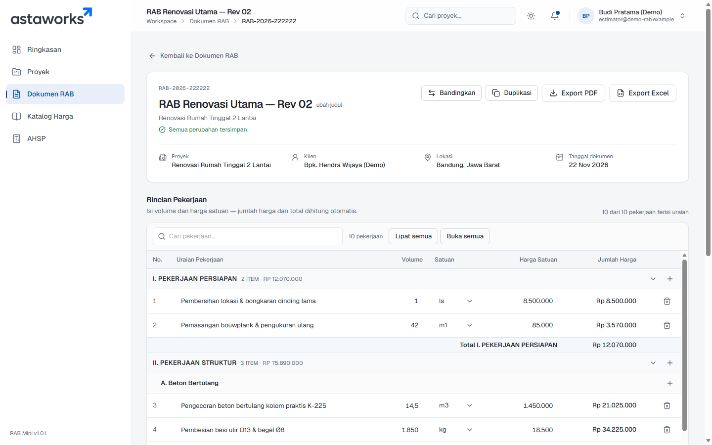
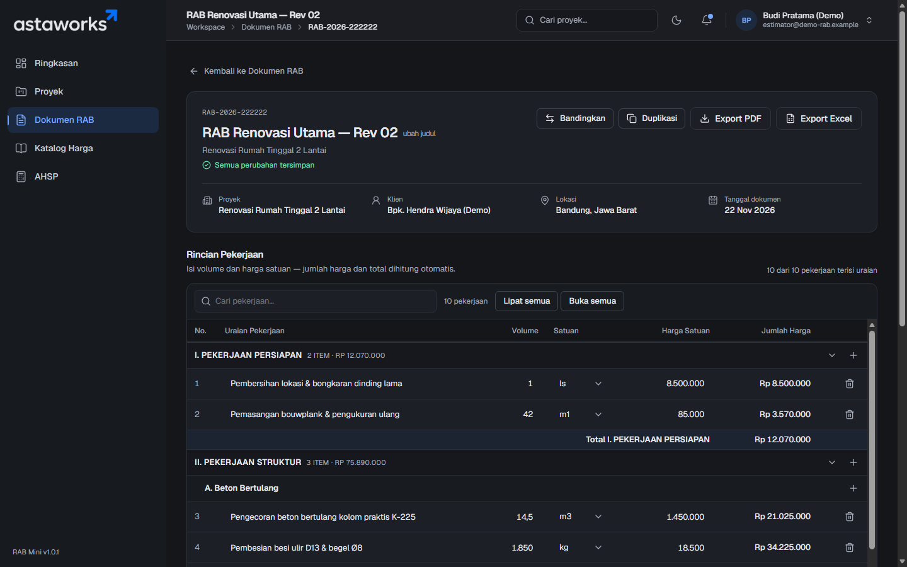
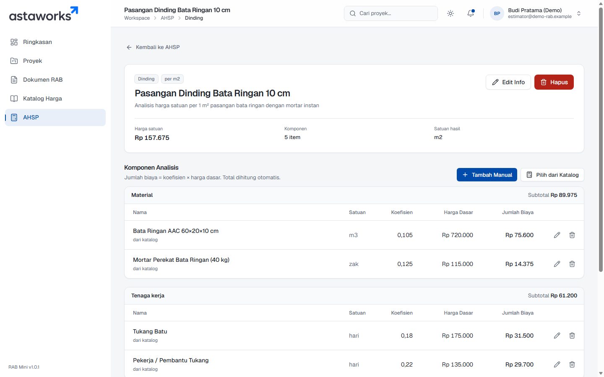
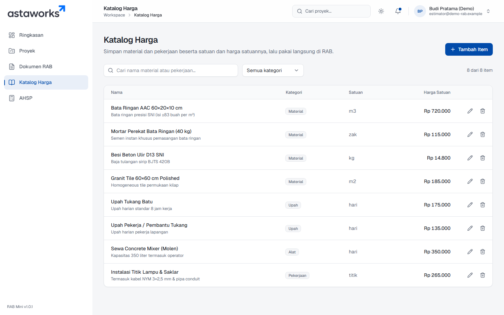
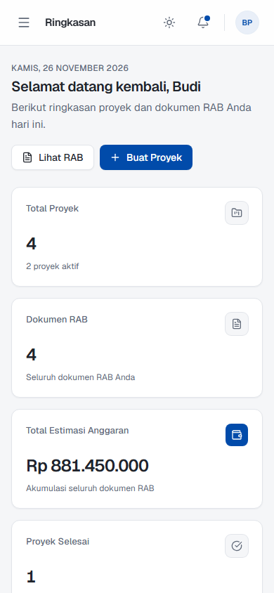

# RAB Mini

**Construction Budget Estimation Web App (*Rencana Anggaran Biaya*)**

[](https://nextjs.org)
[](https://www.typescriptlang.org)
[](https://tailwindcss.com)
[](https://supabase.com)
[](https://asta-rab.vercel.app/)

RAB Mini is a web application built for contractors, architects, and project estimators to create, organize, compare, and export **Rencana Anggaran Biaya (RAB)** — Indonesian construction cost estimates — with database-enforced per-user data isolation.

Every project, RAB document, line item, price catalog entry, and unit price analysis (**AHSP**) is stored in **Supabase Postgres** and protected by **Supabase Auth + Row Level Security (RLS)** so each authenticated user can only read and modify their own workspace.

**Live Production App:** [https://asta-rab.vercel.app/](https://asta-rab.vercel.app/)


*Workspace overview displaying synthetic Indonesian construction projects, aggregated budget totals, and recent RAB documents.*

---

## Key Features

### Project & RAB Document Management
- **Multi-project workspace:** Track construction projects by client, location, start date, and status (`planning`, `active`, `completed`, `on-hold`) with table and card views, search, and status filters.
- **Multiple RAB revisions per project:** Create, rename, duplicate, and compare RAB documents within or across projects.
- **Document comparison:** Compare two RAB documents at the top-level work group (`GROUP`) level with delta amounts, percentage variance, matched/unpaired indicators, and PDF/Excel comparison export.

### Interactive Hierarchical RAB Editor
- **Structured work breakdown:** Supports flat lists as well as 3-level construction hierarchies (`GROUP` → `SUBGROUP` → `ITEM GROUP`) with collapsible sections, group subtotals, and instant item search.
- **Real-time calculations:** Automatically computes line-item totals (`volume × unit price`) and document/project rollups from a single shared pure calculation module (`src/lib/rab-calc.ts`).
- **Ordered autosave & safe recovery:** Optimistic inline edits are debounced per row and serialized through an in-memory save queue (`src/lib/save-queue.ts`) with client-generated UUIDs for idempotent item creation retries, lifecycle flush on page hide, and explicit retry recovery on network errors.

### Hardened Excel Import & Formula-Preserving Export
- **Import from `.xlsx` / `.xls`:** Detects single- and two-row headers, maps common Indonesian and English column aliases automatically, preserves hierarchical group headings, and previews validation results before creating a new RAB document (existing documents are never overwritten).
- **Strict, field-aware numeric parsing:** Reads native Excel numeric cells directly and allows independent text-locale selection (`Auto (strict)`, `Indonesian`, `International`) for **Volume** vs. **Price & Amount** columns — preventing silent misreads on mixed conventions such as volume `"1.500"` (`1.5`) paired with price `"150.000"` (`150,000`).
- **Partial-import safety guard:** Flags formula errors (`#DIV/0!`, `#REF!`, `#VALUE!`), negative values, amount-only rows, and subtotal discrepancies; requires explicit user confirmation when valid and invalid rows appear together.
- **Styled Excel export:** Generates formatted `.xlsx` workbooks (`xlsx-js-style`) with numeric cells, live row formulas (`=Volume*UnitPrice`), `SUM(...)` totals, and optional company letterhead.

### Print-Ready A4 PDF Export
- **Dynamic client-side generation:** Uses `jsPDF` + `jspdf-autotable` loaded via dynamic `import()` so PDF libraries stay out of the main application bundle.
- **Consistent numbers:** Reuses the exact same calculation functions as the UI and Excel exporter, with repeating table headers, page-break guards, page numbering, optional company letterhead, and a 3-column signature block.

### Price Catalog (*Katalog Harga*) & AHSP (*Analisis Harga Satuan Pekerjaan*)
- **Reusable Price Catalog:** Manage materials, labor rates (*Upah*), work items, and equipment with category filters and insert them directly into RAB items or AHSP analyses.
- **AHSP Unit Price Analysis:** Build unit prices from **Material**, **Labor** (*Tenaga kerja*), and **Equipment** (*Peralatan*) components using user-entered coefficients and base prices. Calculations use **BigInt integer arithmetic** (coefficients scaled to micro-units `× 10^6`, prices in cents `× 100`) to avoid floating-point rounding drift.
- **Price snapshot isolation:** Copying an item from the Price Catalog or AHSP into an RAB document stores a snapshot value rather than a live foreign-key price link — updating or deleting catalog/AHSP entries never alters historical RAB budgets.

### Theme & Responsive UX
- **Light, Dark, and System themes:** Persisted per device in `localStorage` (`rab-theme`) with a pre-paint initialization script in the root layout to prevent theme flicker. PDF and Excel exports always use a clean light print layout.
- **Responsive layouts:** Adapts between desktop sidebar navigation and mobile drawer/card layouts.

---

## Visual Tour

All screenshots below were captured from a local instance running against isolated, synthetic Indonesian construction demo data.

| Hierarchical RAB Editor (Light) | Hierarchical RAB Editor (Dark) |
| :---: | :---: |
|  |  |

| AHSP Unit Price Analysis Editor | Price Catalog (*Katalog Harga*) |
| :---: | :---: |
|  |  |

<details>
<summary><strong>Mobile Responsive View</strong></summary>
<br />
<p align="center">
  
</p>
</details>

---

## Technology Stack

| Layer | Technology |
| --- | --- |
| Framework | [Next.js 16](https://nextjs.org) (App Router, Turbopack, Cache Components) |
| Language | TypeScript 5 |
| UI & Styling | React 19, Tailwind CSS v4, [Base UI](https://base-ui.com) primitives, Lucide Icons, Sonner |
| Backend & Auth | [Supabase](https://supabase.com) (`@supabase/supabase-js`) — Postgres, Email Auth, Row Level Security |
| Document Export / Import | `jspdf`, `jspdf-autotable`, `xlsx-js-style` |
| Testing & Quality | Node.js built-in test runner (`node:test`), ESLint 9, TypeScript compiler (`tsc`) |
| Hosting | Vercel |

---

## Technical Architecture

### Data Ownership & Security Boundaries

Authentication gates in the UI (`AuthGate`) control user experience only. **PostgreSQL Row Level Security (RLS)** is the actual security boundary: without a valid authenticated Supabase session, all database queries are rejected by Postgres.

```text
auth.users (Supabase Auth)
 ├── projects.user_id = auth.uid()
 │    └── rab_documents (ownership inherited via EXISTS on projects)
 │         └── rab_items (ownership inherited via EXISTS on rab_documents → projects)
 ├── price_catalog.user_id = auth.uid()
 └── ahsp_analyses.user_id = auth.uid()
      └── ahsp_components (ownership inherited via EXISTS on ahsp_analyses)
```

- All 6 business tables enforce `SELECT`, `INSERT`, `UPDATE`, and `DELETE` RLS policies restricted to the `authenticated` role.
- Child tables (`rab_documents`, `rab_items`, `ahsp_components`) verify parent ownership via `EXISTS (...)` in both `USING` and `WITH CHECK` clauses, preventing cross-account record reassignment.
- Deleting a user or parent entity cascades cleanly via `ON DELETE CASCADE`.
- The browser client (`src/lib/supabase/client.ts`) uses only the public Supabase URL and publishable key; service role credentials are never used in the web application.
- Optional user profile and company letterhead metadata are stored per account in Supabase Auth `user_metadata` (`full_name`, `company`) with blank defaults.

### Application Data Flow & Autosave Model

1. **Session-first hydration:** `AuthProvider` restores the persisted Supabase session (`localStorage` key `rab-mini:auth`). `DataProvider` loads workspace data only after authentication succeeds and clears state immediately on sign-out.
2. **Parallel workspace loading:** Projects, RAB documents, and work items are fetched in parallel with paginated queries (`src/lib/supabase/paginate.ts`), and derived metrics (item counts, document totals, project totals) are deterministically recomputed in memory.
3. **Ordered write queue (`src/lib/save-queue.ts`):**
   - Inline row edits apply optimistically and debounce for `500 ms` per item.
   - Structural operations (add/delete) and document metadata updates are serialized so newer edits wait for in-flight requests and stale responses never overwrite newer revisions.
   - Document duplication and comparison exports await pending writes for affected documents before reading snapshots.
   - On `visibilitychange` / `pagehide`, the queue flushes pending edits immediately without waiting for debounce timers.

### Repository Structure

```text
src/
├── app/                 # Next.js App Router pages (/login, /register, /dashboard, /projects, /rab, /catalog, /ahsp, /settings)
├── assets/branding/     # Astaworks brand logo sources and generated theme variants
├── components/
│   ├── ahsp/            # AHSP list, editor, and component dialogs
│   ├── auth/            # AuthGate and email/password forms
│   ├── catalog/         # Price catalog list and CRUD dialogs
│   ├── dashboard/       # KPI summary, recent projects/documents, legacy migration banner
│   ├── layout/          # AppShell, ProtectedShell, sidebar, header, theme menu, BrandMark
│   ├── projects/        # Project table/cards, detail view, form dialog
│   ├── providers/       # ThemeProvider, AuthProvider, DataProvider
│   ├── rab/             # RAB list, ImportExcelDialog, CompareDocumentsDialog, DuplicateDocumentDialog, export buttons
│   │   └── editor/      # RabEditor, DocumentHeader, WorkItemsTable, RabSummary, SaveStatus
│   ├── settings/        # User profile, optional company letterhead, theme preferences
│   ├── shared/          # Reusable UI states (PageHeader, StatCard, StatusBadge, EmptyState, ConfirmDialog)
│   └── ui/              # Base UI primitives (Button, Card, Dialog, Input, Select, Table, …)
├── hooks/               # useNow, use-rab-pdf-export, use-catalog, use-ahsp
├── lib/                 # Pure domain logic (rab-calc, rab-hierarchy, rab-compare, duplicate-rab, ahsp, excel-import, rab-excel, rab-pdf, save-queue)
│   ├── auth/            # Auth error message mapping
│   └── supabase/        # Browser client, paginated CRUD modules, legacy localStorage migration
└── types/               # Shared domain TypeScript interfaces

supabase/
├── schema.sql           # Complete schema, indexes, triggers, and RLS policies for fresh installs
└── migrations/          # Incremental migrations (0002_auth_ownership → 0003_price_catalog → 0004_ahsp → 0005_rab_item_structure)

scripts/
├── test-excel-import.mjs  # Offline regression suite for Excel import parser & workbook round-trip (25 tests)
├── autosave.test.mjs      # Offline regression suite for save queue, recovery, duplication, and compare flushes (21 tests)
├── smoke-*.mjs            # Live Supabase smoke tests (CRUD, RLS isolation, catalog, AHSP, import)
└── release/               # Operator backup, cleanup, verify-empty, and restore scripts for v1.0.0

docs/
├── media/                 # Portfolio screenshots (synthetic demo data)
├── release-v1.0.0.md      # v1.0.0 backup, cleanup, restore, and deployment runbook
└── release-v1.0.1.md      # v1.0.1 release notes (blank company defaults & favicon)
```

---

## Local Development & Installation

### Prerequisites
- **Node.js 20.11+** and `npm`
- A [Supabase](https://supabase.com) project with the **Email** auth provider enabled

### 1. Clone and Install Dependencies

```bash
git clone https://github.com/Skiidig/asta-rab.git
cd asta-rab
npm install
```

### 2. Set Up the Supabase Database

Open the **SQL Editor** in your Supabase project:
- **New project:** Run [`supabase/schema.sql`](supabase/schema.sql) once to create all tables, indexes, triggers, and RLS policies.
- **Existing project (incremental upgrade):** Run the migrations in order:
  1. [`supabase/migrations/0002_auth_ownership.sql`](supabase/migrations/0002_auth_ownership.sql)
  2. [`supabase/migrations/0003_price_catalog.sql`](supabase/migrations/0003_price_catalog.sql)
  3. [`supabase/migrations/0004_ahsp.sql`](supabase/migrations/0004_ahsp.sql)
  4. [`supabase/migrations/0005_rab_item_structure.sql`](supabase/migrations/0005_rab_item_structure.sql)

In **Authentication → Providers**, ensure **Email** is enabled. For quick local testing, you can disable *Confirm email* or create a confirmed user directly under **Authentication → Users**.

### 3. Configure Environment Variables

Create `.env.local` in the repository root using your Supabase **Project URL** and **Publishable Key** (*Project Settings → API Keys*):

```env
NEXT_PUBLIC_SUPABASE_URL=https://<your-project-ref>.supabase.co
NEXT_PUBLIC_SUPABASE_PUBLISHABLE_KEY=sb_publishable_<your-publishable-key>
```

> **Security note:** Only public client keys belong in `.env.local`. Never place a Supabase `service_role` key in `.env.local`, `NEXT_PUBLIC_*` variables, or version control.

### 4. Run the Application

```bash
npm run dev
```

Open [http://localhost:3000](http://localhost:3000). Unauthenticated visitors are redirected to `/login`.

Additional scripts:

```bash
npm run build   # Production build + TypeScript check
npm run start   # Start production server
npm run lint    # Run ESLint
```

---

## Testing & Quality Checks

### Offline Regression & Static Checks

Run directly from the repository root (requires Node.js 20.11+, no Supabase credentials or browser needed):

```bash
node --test scripts/test-excel-import.mjs
node --test scripts/autosave.test.mjs
npm run lint
npx tsc --noEmit
npm run build
```

- `scripts/test-excel-import.mjs` — 25 tests covering numeric locale parsing, mixed Volume/Price conventions, hierarchical row classification, formula-error rejection, partial-import guards, and Excel export/import round-trips.
- `scripts/autosave.test.mjs` — 21 tests covering ordered writes, coalescing, idempotent add retries, page-hide flushes, and snapshot consistency for duplication and comparison exports.

### Live Supabase Smoke Tests

To verify CRUD and cross-user RLS isolation against a configured Supabase test project, provide confirmed test account credentials via shell environment variables (never commit credentials):

```powershell
# PowerShell example (use dedicated test accounts)
$env:RLS_EMAIL_A="user-a@example.com"; $env:RLS_PASSWORD_A="<test-password-a>"
$env:RLS_EMAIL_B="user-b@example.com"; $env:RLS_PASSWORD_B="<test-password-b>"

node scripts/smoke-crud.mjs
node scripts/smoke-auth-rls.mjs
node scripts/smoke-catalog.mjs
node scripts/smoke-ahsp.mjs
node scripts/smoke-import.mjs
```

---

## Deployment & Release Documentation

RAB Mini deploys as a standard Next.js application (currently hosted on **Vercel** via Git integration on `main`).

- Configure `NEXT_PUBLIC_SUPABASE_URL` and `NEXT_PUBLIC_SUPABASE_PUBLISHABLE_KEY` in the hosting environment.
- Configure Supabase **Authentication → URL Configuration** (`Site URL` and `Redirect URLs`) to match the production domain (`/login`, `/register`).
- See [`docs/release-v1.0.0.md`](docs/release-v1.0.0.md) for the operator backup, cleanup, restore, and deployment runbook.
- See [`docs/release-v1.0.1.md`](docs/release-v1.0.1.md) for v1.0.1 release notes (blank company identity defaults and Astaworks favicon).

> **Version note:** `package.json` is currently at `1.0.1`. Commits on `main` after `v1.0.1` include RAB editor performance improvements, Excel import validation hardening, and ordered autosave recovery.

---

## Known Limitations

- **In-memory autosave queue:** Pending edits live in browser memory (`SaveQueue`). A sudden browser crash, forced tab kill, or prolonged offline disconnect before requests settle can drop unacknowledged edits. Persistent per-account local replay with server-side revision checks is a planned future architectural improvement.
- **Non-atomic Excel import cleanup:** Importing an Excel file creates the RAB document and then inserts work items in batches from the client. If an item batch fails mid-way, the app performs best-effort cleanup to delete the new document; if cleanup also fails (e.g., lost connection), an empty or partial document may remain and require manual deletion.
- **Excel hidden rows/columns:** `xlsx-js-style` does not expose hidden row/column visibility metadata, so hidden rows in source spreadsheets are read along with visible rows.
- **Import limits:** Excel uploads are capped at 5 MB, 1,000 imported items per document, and 5,000 scanned rows per worksheet.
- **No bundled official AHSP coefficients:** By design, RAB Mini does not ship pre-filled SNI or government AHSP coefficients; users enter and maintain their own coefficients and unit prices.

---

## Credits & Third-Party Attribution

- **Frameworks & UI:** [Next.js](https://nextjs.org), [React](https://react.dev), [Tailwind CSS](https://tailwindcss.com), [Base UI](https://base-ui.com), [Lucide Icons](https://lucide.dev), [Sonner](https://sonner.emilkowal.ski)
- **Typography:** [Geist & Geist Mono](https://vercel.com/font) loaded via `next/font/google`
- **Backend:** [Supabase](https://supabase.com) (`@supabase/supabase-js`)
- **PDF & Excel:** [jsPDF](https://github.com/parallax/jsPDF), [jsPDF-AutoTable](https://github.com/simonbengtsson/jsPDF-AutoTable), [xlsx-js-style](https://github.com/gitbrent/xlsx-js-style)
- **Branding Assets:** Astaworks logo and favicon assets in `src/assets/branding/` and `src/app/` belong to the repository owner.

---

## License

**All Rights Reserved — No Open-Source License Granted.**

This repository is publicly visible for portfolio and code-review purposes (`"private": true` in `package.json`, no `LICENSE` file). Unless explicit permission or an open-source license is added by the copyright holder, redistribution, modification, or commercial use is not permitted.
